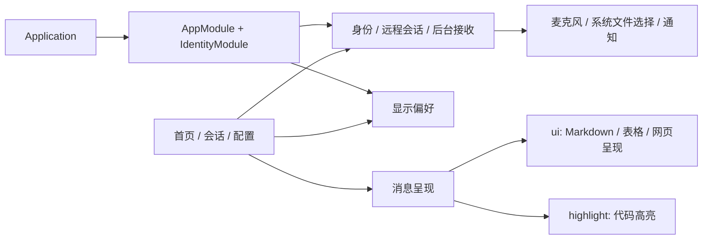

# Fairy 客户端运行组成

Android 客户端在本仓库 `android/` 目录，围绕首页互动、会话对话和分组配置装配。客户端以快照方式并入本仓库，来源提交见 [ourfairy-source.json](../../ourfairy-source.json)；拓扑、来源与版本组合的唯一权威是仓库根 [README.md](../../../README.md) 与 [combo.json](../../../combo.json)。

## 装配与保留理由

| 保留能力 | 当前用途 | 实现位置 |
| --- | --- | --- |
| 身份、会话归属、法厄同网关 | 登录后进入自己的会话，法厄同配置共用模型并生成邀请码 | `data/remote/`、`ui/identity/`、`ui/fairy/FairySettingsPage.kt` |
| 发送确认、重连、通知消费记录 | 发送状态不确定时对账，后台接收与恢复时合并提醒 | `data/remote/RemoteChatState.kt`、`data/remote/RemoteReceiveState.kt`、`data/remote/ChatSyncStore.kt` |
| 录音、文件选择与上传下载 | 语音转写回到草稿，图片和文件传给远程会话 | `data/remote/RemoteSpeechCapture.kt`、`ui/identity/RemoteAttachmentFiles.kt`、`ui/identity/RemoteChatPanel.kt` |
| Markdown、代码、表格、公式、图片及图表 | 完整呈现 Fairy 的回复，复用解析、高亮及阅读位置保护 | `ui`、`highlight`、`ui/components/richtext/` |
| Fairy 主题与动画 | 三处主要体验共用固定主题和运行状态呈现 | `ui/fairy/` |
| 字号、字体 | 当前显示分组可操作的两项本地偏好 | `data/datastore/DisplayPreferences.kt`、`ui/identity/RemoteDisplayPreferences.kt` |

客户端装配 module 的 interface 收窄到产品入口所需的依赖，装配 seam 留在现有 `di/`。远程契约和 Android adapter 沿用现有实现，调用方因此不必理解本地模型、媒体和工作区的初始化顺序。启动路径由 `app/src/test/java/me/rerere/rikkahub/ClientStartupTest.kt` 覆盖，远程协议与恢复由 `app/src/test/java/me/rerere/rikkahub/data/remote/` 下的测试覆盖，两者都由 `./gradlew test` 执行。
