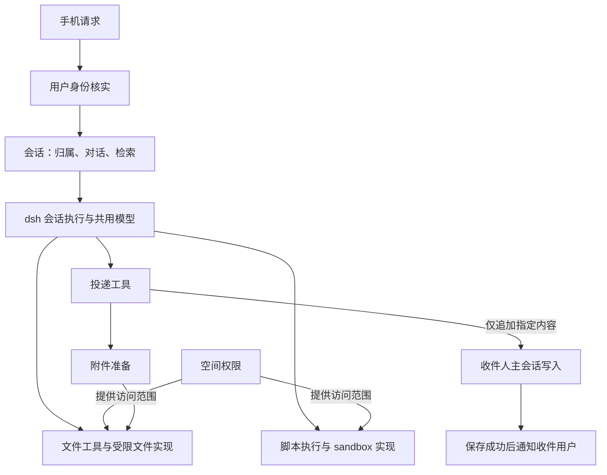

# 首版后端最小模块设计草案

日期：2026-10-14。状态：首版装配决定已收束，本文保留实现规划素材；没有实施产品代码。最终决定以[确定后端最小装配：选用、替换与新增插件](https://github.com/eafen405/OurFairy/issues/9#issuecomment-6163738839)为权威，后端地图已完成。本文中的接口示意和验证清单不代表已完成兼容验证。

## 首版范围

受邀多用户、每用户多会话和固定主会话、永久会话归属、对话与恢复、同用户会话检索和区间读取、跨用户文字及文件投递、手机通知对接、Fairy 基本文件和脚本能力。先共用模型配置与凭据，允许联网。子代理、记忆、定时任务、技能及个人模型选择不进入首版装配。

公有与群组空间由 Fairy 执行读写，用户通过对话与交付物参与。一个 Fairy 服务多人，不代表各用户的私有内容合并。共享模型配置也不共享聊天上下文。

2026-10-14 用户明确投递语义：内容供收件用户阅读，表现为收件方 Fairy 已发送的消息；保存到主会话并触发手机通知，等待用户响应，不自动启动接收方推理。后续用户回复时，这条消息属于已发生的会话历史。此项已确定，不再作为产品待决项。

最小装配讨论新增确认：首版对话模型只接 DeepSeek 官方 API；手机断线后后端继续执行，显式停止才取消；允许 Fairy 告知“正在安装”等长任务进展后继续处理对话，后续查看结果或停止任务。需要国内 Android 后台消息能力，不能依赖 Google 服务，首批验证设备为 vivo S50，仅安装自用 APK。手机断线继续不等同于服务器重启后自动续跑进程。

## 建议的运行方式

用户作用域已收束到[确定用户作用域：身份如何贯穿会话与执行](https://github.com/eafen405/OurFairy/issues/7)。共享装配及作用域矩阵已由[确定共享与限制：能力在何处按用户提供](https://github.com/eafen405/OurFairy/issues/8#issuecomment-6163344040)确认，该票结论为权威记录。具体插件选择与适配职责已在最小装配票收束，精确编码和验证留给实现。

首版采用一套后端装配，共享模型配置及基础设施，每个会话保留独立日志、上下文和执行状态。执行身份由不可变会话归属取得，不使用进程级“当前用户”变量，不因另一个手机请求而切换所有插件的身份。并发调用的身份绑定到各自执行过程；下游已有显式 Session/Agent 参数时继续传递，不通过新全局上下文隐藏权限依据。

上述共享方式已确认。依据是普通工具已有 exec.agent、sandbox policy 已有 sessionId，且旧 Fairybot 已在这些接口实现多用户文件访问。直接复用、原生模块二次适配及旧实现适配的划分见共享与限制票的结论；具体兼容性尚待验证。

## 用户作用域：检查位置与改动范围

身份模块核实外部请求者；会话模块据永久归属决定是否允许操作目标会话。后端内部恢复和投递使用明确的内部调用路径，不伪装成登录用户，也不给外部请求一个跳过权限的选项。

| 入口 | 身份依据 | 检查时点与责任 |
| --- | --- | --- |
| 新建会话 | 已认证用户 | 会话模块在发布/保存前写入归属，不接受客户端或模型任意指定归属 |
| 列表、搜索、历史、订阅 | 已认证用户 | 会话模块在返回内容或建立订阅前限定范围；搜索在排名截断前过滤 |
| 向既有会话发送、恢复、取消等控制 | 请求者与目标 header | 在执行副作用前核对归属，live Agent 命中也检查；不能只在恢复后的 setup 检查 |
| Fairy 查询其他会话 | 当前执行的 Agent.session | 检索按同用户限定；区间读取单独核对目标，无会话身份的模型调用拒绝 |
| 重启恢复、脱离连接继续执行 | 持久化 header | 保留原用户；归属缺失不猜测、不默认为用户 1、不当成公共会话 |
| 文件、附件、脚本 | 当前会话归属与空间规则 | 文件实际访问和命令启动分别落实限制；HTTP 附件入口核对已认证用户的访问资格 |
| 跨用户投递 | 来源会话身份、显式收件编号 | 投递模块校验可用源文件并取得收件主会话的窄写入能力；不读取收件上下文 |
| 手机通知与同步 | 已保存消息的目标会话归属 | 接入模块只向该用户的订阅/设备发送；连接变化不改变归属 |

会话归属是业务权威，允许维护可重建的查询索引或缓存，不再引入另一份独立权威归属表。用户编号短不影响授权：知道编号或会话 ID 均不构成读取资格。法厄同的管理身份不免除个人内容检查。

| 原生改动链路 | 必要变化 |
| --- | --- |
| SessionHeader、CreateSessionOptions.meta、CreateAgentOptions.meta | 增加并传递永久用户归属，字段名可用 ownerUserId；每条 Message 不重复添加用户归属 |
| Session 校验、prepare/create 与恢复 | 创建时校验并冻结归属；从持久化 header 恢复，发布前保持一致 |
| JSONL header 编解码与 catalog 映射 | 完整往返保存归属；旧格式拒绝未知字段，必须按版本兼容规则适配，不直接修改已发布旧格式定义冒充兼容 |
| session-query header 一致性、查询过滤与 SQLite 索引 | 保存并核对归属，支持按授权范围查询；索引可重建，不能成为另一份归属权威 |
| 外部会话 API 与事件出口 | 把单操作者入口适配成用户范围，覆盖 live/cold 会话、上传下载和订阅 |
| 文件与 sandbox 对接 | 从会话取得用户，适配旧权限实现；复用现有工具参数，保持联网能力与文件隔离 |

若首版开放会话 fork，必须继承归属；未开放则关闭该入口。子代理不在首版，不为本票新增子代理实现任务。格式版本号、索引迁移代码和插件最终依赖清单属于后续实现设计，不影响归属承载方式的结论。

源码定位见[归属执行路径](research/session-owner-execution.md)。额外核对点：dsh `core/session/src/types.ts:94,151`、`core/agent/src/index.ts:79`（均在 packages/）；`session/session-persistence-jsonl/src/format.ts:96`、`session/session-format-v3-to-v4/src/validation.ts:19`、`session/session-format-v1-to-v2/src/codec.ts:19`；`session-query/session-query/src/sources.ts:11`。以上为静态证据，尚未实施或运行兼容测试。

## 模块及数据归属

空间规则已在[共享与限制讨论](https://github.com/eafen405/OurFairy/issues/8#issuecomment-6162900277)明确：Fairy 在会话中使用所属用户的私有空间、所属群组空间和公有空间，文件操作与脚本执行沿用同一范围。公有文件直接共享使用。法厄同创建群组并指定群主，群主管理成员。允许联网和安装依赖；安装路径随实际执行环境落实，按用户隔离依赖环境不是产品要求。设计以这条空间规则为准，避免重复授权和额外权限配置。

模块是职责划分，不要求每行建立独立 npm 包，更不代表把一行的全部实现挤进一个文件。

| 模块 | 自己维护的事实与规则 | 对其他模块提供什么 |
| --- | --- | --- |
| 用户身份 | 邀请注册、短用户编号、登录凭据、管理身份 | 核实请求者，查找有效收件用户；不保存会话正文 |
| 会话 | header 中的永久归属、固定主会话关系、日志和执行生命周期、归属检查 | 创建/恢复本人会话，按用户检索，按区间读取；向主会话追加投递内容的内部窄接口 |
| 空间权限 | 空间归属、成员关系及由此得到的访问范围 | 按执行用户计算可读写范围；不执行 shell、不管理手机连接 |
| 文件与附件 | 文件操作的实际授权检查、附件保存及可用引用 | dsh 的文件接口；将已获准文件准备为可交付附件，并供收件会话使用 |
| 脚本执行 | 将授权范围落实到进程可见目录、环境与执行限制 | dsh 的 sandbox 接口；进程运行、取消与超时复用 dsh |
| 投递 | 指定收件用户、内容及文件的送达流程，内部重试所需的送达身份 | 给 Fairy 一个投递工具；协调附件准备与主会话写入，成功后产生送达事实 |
| 客户端接入与通知 | 登录连接、按用户订阅、协议编码和手机通知通道 | 把已认证请求交给相应模块，向正确用户传送已经保存的结果 |

会话检索属于会话模块，可有独立查询文件及索引实现，不另造一层只有转发功能的“检索总管”。模型调用沿用 dsh provider，首版由部署提供共用配置，不提前构建个人凭据系统。

投递内部必须协调附件与会话写入，这是同一个送达职责。启动装配仅创建并连接依赖；不会把投递流程、成员判断、身份校验和通知实现收进同一个 host/manager 文件。客户端协议文件也不直接读写业务数据库。

## 依赖与接口



图中的主会话写入由会话模块提供，附件准备属于文件与附件模块，不表示额外创建两套模块。空间权限不依赖投递或客户端，脚本实现不依赖会话检索。通知接收的是已经保存的送达事实，不负责决定投递是否允许。

Fairy 的外部工具保持此前确认的形状，名字为示意：

```text
search_my_conversations(query)
  -> sessionId + matches[{seq, text}]

read_conversation_range(sessionId, startSeq, endSeq)
  -> 区间内内容，排除工具结果，保留原 seq

deliver_to_user(userId, content, files?)
  -> 文件可有可无；文件引用形式及数量尚未最终确定
```

检索仅查询当前用户的会话；片段约 50–100 字，止于命中消息边界。区间端点建议含首尾，seq 是会话事件位置，不承诺区间每个 seq 都对应返回的聊天消息。工具结果排除不自动决定 reasoning 等其他内容的返回策略。

当前用户由执行会话内部确定，不是模型参数。区间读取单独核对目标归属，不能把已知 sessionId 当作权限。搜索先限制用户范围再排名和截断。投递的 userId 仅选择接收方，不改变执行者身份，不授予对方正文的读取接口；发送端可用文件的授权检查仍然存在，但不增加二次分享审批。

内部接口按调用方授予所需能力：普通会话读取必须携带已认证用户或已归属执行身份；投递仅持有主会话写入能力，不拿通用的“忽略归属检查”选项。具体 TypeScript 类型和持久化表由这些职责推导，不在本草案中先行制造公共万能 Context。

## 复用、适配与新增

以下是装配候选，逐项落实时须说明复用对象是接口、工具、底层能力还是具体实现，并列明二次适配位置。共享与限制票已区分：现有模型和执行传递等基础能力可直接复用；会话、格式、查询及接入需原生二次适配；文件与 sandbox 复用 dsh 接口和工具，以旧 Fairybot 实现为基础适配。产品职责的具体适配或补充仍由最小装配票决定。

| 能力 | 首版处理方向 |
| --- | --- |
| Agent、执行循环、工具注册、系统提示与会话投影 | 复用 dsh 基础能力；每会话执行身份需落实，按实际依赖装配 |
| 会话持久化及查询 | 复用 dsh 日志与查询机制，增加永久归属和用户过滤；格式兼容需要正式处理 |
| read/write/edit/read_image、bash | 复用工具接口；接入适配后的权限实现，工作目录变化不扩大权限 |
| fs 与 sandbox 实现 | 以旧 Fairybot 实现为基础适配，接入会话归属和统一空间权限；允许联网 |
| 用户身份、固定主会话、同用户工具、跨用户投递 | OurFairy 产品职责，借鉴旧实现并去除旧规则和结构耦合 |
| 附件与客户端事件 | 复用可用存储和传输机制，补所属用户/接收会话授权及通知接线；不直接暴露原生单操作者 API |

这不是已经通过启动测试的完整插件清单。已核实 agent-loop、tool-fs、tool-bash 的直接注入依赖没有要求挂载子代理、记忆、定时任务、技能；完整依赖闭包及客户端默认插件仍需验证，不能以此宣称任意原生 profile 都能直接裁剪。

### 显式装配候选

以下包名省略 `@deepseek-ai/` 前缀；表格区分运行时挂载与实现复用，不表示每个 npm 代码依赖都需显式挂载。最终完整启动闭包尚未运行验证。

| 职责 | 实际包或实现候选 | 直接复用部分 | 二次适配或补充 |
| --- | --- | --- | --- |
| 执行内核 | `dsh-agent`、`dsh-agent-loop`、`dsh-tools`、`dsh-system-prompt`、`dsh-session-projection` | 循环、工具注册、系统提示及会话投影机制 | 创建和恢复传递永久归属；Fairy 提示装配及投递投影按产品语义落实 |
| 共用模型 | `dsh-llm`、`dsh-llm-deepseek-api-key`、`dsh-agent-default-model` | 官方 API provider 与共享配置路径 | 首版只配置 DeepSeek 官方路由；不装个人凭据选择 |
| 会话 | `dsh-session`、`dsh-session-persistence-jsonl`、`dsh-session-checkpoint-policy` | 日志、恢复和写入机制 | header 归属、正式格式升级及访问核对 |
| 查询 | `dsh-session-query-sqlite` | 搜索和可重建索引 | 显式启用；增加归属过滤并适配已定检索／区间工具 |
| 文件与目录 | `dsh-tool-fs`、`dsh-working-directory`；旧 `ProcessingFileSystem` 适配实现 | 文件工具、目录状态机制、现有文件接口 | 空间规则、实际读取限制及执行身份绑定，覆盖目录 ensure 的 resolve/stat 路径 |
| shell | `dsh-tool-bash`、`dsh-bash-sandbox`、`dsh-shell-env`、`dsh-subprocess-local`、`dsh-sandbox-policy`；旧 `BwrapSandboxProvider` 适配实现 | 工具、进程运行、超时、取消及 sandbox 接口 | 按会话范围限制进程，接入联网和依赖安装，覆盖 full-access 绕过入口 |
| 长任务与对话并行 | 挂载 `dsh-jobs-local`、`dsh-tool-jobs`；`dsh-jobs` 为接口代码依赖 | 后台任务句柄、查看输出、终止和完成反馈能力 | 手机入口按会话归属授权，任务状态／结果按所属用户路由 |
| 附件 | `dsh-attachment-local` | 不可变内容寻址存储与引用 | 上传、下载及投递到收件会话的访问资格 |
| 用户与空间 | 旧身份注册、邀请事务和空间成员操作作为素材 | 已有局部业务逻辑与 SQLite 使用经验 | 短数字用户编号、群主及成员关系；会话 header 保持归属权威 |
| 投递与客户端 | 旧投递流程、手机 HTTP/SSE 接入作为素材 | 可复用的认证、历史投影、补页和传输机制 | 多会话入口、Fairy 输出投递、持久送达记录、后台消息通道与事件路由 |

`dsh-base` 默认组合包含子代理、技能及其他首版未选功能，首版采用显式 OurFairy profile。`sdk-minimal` 也不是可直接使用的产品配置，其文件与执行范围不满足已定空间规则。默认查询设置 `openAt: never`，需要显式启用正文检索。用户已确认需要长任务与对话并行，因此首版纳入 jobs；该能力与定时任务不同，不承诺进程跨服务器重启续跑。

jobs 原生按所属 sessionId 和 Agent 生命周期核对调用；建议直接复用输出／列表／停止工具和默认完成反馈：Agent 忙时结果进入后续上下文，空闲时唤醒同一 Agent 报告结果。这是当前会话长任务的继续处理，与跨用户投递只保存通知的语义分别保持。手机入口先验证请求者拥有任务所属会话；停止生成和终止已在后台运行的脚本分别接线。任务存放于内存，Agent 销毁会取消所属任务，因此不能把手机连接生命周期绑定到 Agent 销毁。

### 已确认的持久化分工

| 数据 | 存放位置与权威 |
| --- | --- |
| 会话归属、正文和事件 | 适配后的 dsh 会话日志，归属权威仍为 header |
| 会话查询数据 | 独立 SQLite 派生索引，可重建；不放业务权威数据 |
| 附件内容 | dsh 本地不可变内容寻址存储 |
| 用户、邀请码、群组及成员、主会话关系、必要的投递与通知记录 | 独立业务 SQLite，各模块维护自己的规则与读写 |

用户已确认这套分工。共享一个业务数据库文件不表示由同一模块统筹所有业务；主会话关系由会话模块维护，群组成员关系由空间模块维护。旧 Fairybot 的独立会话 owner 表不继承为第二份归属权威。dsh 查询库 schema 可被重置重建，不能将上述业务数据混入其中。具体目录、表定义和迁移步骤仍属于实现规划。

### 投递写入的适配方向

建议增加正式投递事件（名称暂用 `delivery/message`），保存投递标识、来源及附件引用；会话投影将其呈现为 Fairy 发言，并纳入接收方后续模型历史。原生 `assistant/message` 的验证要求 `source.kind=model` 以及 turn/step/stream，直接套用会伪造模型生成信息。投递不能只作为可忽略扩展记录，否则不会进入模型历史。

这需要二次适配会话事件类型、格式 catalog／版本校验、消息投影和相关消费端。`registerMessageProjection` 只能修改已经存在的消息节点，单独注册投影插件不足以使新事件成为消息。使用现有写入序列与单写者机制，补充投递的窄追加入口；live/cold 会话、与生成并发、重试去重及恢复一致性仍需验证。产品语义沿用已确认的保存、通知、等待用户响应。

### 手机后台消息方案

用户明确首批设备 vivo S50，国内网络、不依赖 Google 服务、仅安装自用 APK。vivo 官方推送 FAQ 要求应用上架才具备线上推送能力；未上架应用只能受限测试，且测试消息不能发送给离线设备。因此不将 vivo 正式推送当作当前可直接采用的通道。

建议首版适配旧 Android 前台服务维持连接的方案，接收后端已保存事件后展示系统通知；后端维护可恢复的送达依据，重连补取、客户端去重。需用户完成目标系统的通知／后台运行设置，并在 vivo S50 验证切后台、锁屏、断网重连与进程回收。Doze 可能暂停普通网络，前台服务不构成锁屏即时到达保证。具体 Android 交互和省电设置说明交前端票，后端契约明确会话标识、事件定位、订阅范围及补取方式。

正式厂商推送作为满足上架等条件后的可选通道，消息保存与客户端同步不依赖它。研究来源：https://dev.vivo.com.cn/documentCenter/doc/156 及[国内 Android 后台送达研究](research/domestic-android-background-delivery.md)。用户已接受这套首版方案；接收进程被回收时连接中断，恢复前无法及时提醒，这是通道边界，不能只描述成测试尚未完成。

## 关键流程与失败归属

1. 新建会话：身份模块核实用户，会话模块写入永久归属。主会话创建与绑定由会话模块保证一致，不能按“最近使用”推断。
2. 普通请求：在会话恢复、正文读取或执行前核对请求者归属；恢复从保存的 header 取得用户。用户已确认客户端断线后继续执行，显式停止才取消，重连同步结果。
3. 文件或脚本：从当前执行得到用户，空间权限提供范围，实际文件打开与子进程均执行限制。联网不扩大可读文件范围，不直接照搬原生允许整根读取的 sandbox 配置。
4. 跨用户投递：检查明确选定的源内容和文件是否可用，解析对方主会话，将指定内容保存为 Fairy 已发送的消息，再通知收件用户，等待其响应。不得把投递排成接收方需要处理的用户请求，不因送达创建或唤醒新推理。内部来源区分投递与收件侧模型现场生成，具体事件编码仍需适配 dsh。附件准备失败时不能报告完整送达；通知失败不回滚已经保存的消息。
5. 重试和重启：投递模块应让内部重试指向同一次送达，防止重复插入；通知要有可恢复的发送依据，避免保存后崩溃永久漏通知。可以利用已有持久化日志/记录，不为此预设独立消息队列。是否能利用现有工具调用身份实现幂等仍待验证。

## 尚需具体化

- 首版后台消息针对国内无 Google 依赖环境，首批设备 vivo S50、仅自用 APK；前台服务连接方案已确定，锁屏实测待后续执行。持久保存、重连补取与系统提醒分别验证。
- 后台任务纳入 jobs，完成反馈与显式停止接线需核对；手机断线本身不构成取消。
- 会话 header 的格式升级、旧日志归属及查询过滤改动；首版不支持子代理，其继承改动不作为首版交付要求。
- 文件与脚本接口适配、允许联网的实现，以及所有模型可达执行入口不能通过 full-access 绕过用户范围。
- 投递消息的产品语义已确定为 Fairy 发言、仅保存通知并等待用户响应。仍需核查对应的 dsh 事件与来源编码，以及接收会话正在生成时如何有序保存、如何在用户响应后的模型历史中呈现；不能伪造收件侧模型调用或把投递变为自动执行请求。
- 手机在线事件、离线通知与重连补读的最小契约；附件引用和访问接口。
- 群组成员管理的最小入口、检索总输出预算和中文匹配行为。

后续实现验证应至少覆盖：显式 profile 启动及依赖缺失；归属格式往返与恢复；两用户文件和脚本范围一致；同用户跨会话检索及越权读取拒绝；投递 live/cold 和正在生成的会话、落盘后通知与重试去重；手机断线后继续执行、显式停止和重连同步；vivo S50 后台／锁屏／网络恢复。此处为验证清单，未执行。

前三份研究分别支持会话事件定位、身份传递和 sandbox 复用：[消息模型](research/message-model.md)、[归属执行路径](research/session-owner-execution.md)、[sandbox 对照](research/dsh-sandbox-reuse.md)。本草案没有把这些未验证点当作完成项，也不把首版之外能力重新列为首版待办。

源码补充：dsh `packages/core/agent-loop/src/index.ts:342`、`packages/fs/tool-fs/src/index.ts:23`、`packages/shell/tool-bash/src/index.ts:34` 为直接注入依赖；`packages/core/agent-loop/src/agent.ts:155` 的 send/inject/followup 面向 UserMessage，不能因为 inject 不主动唤醒就直接拿来实现 Fairy 已发送的投递消息。版本均为上述研究记录的 `d743267388641bc76f17c45ce8b4c231aed1d32c`。未运行测试或原型。
