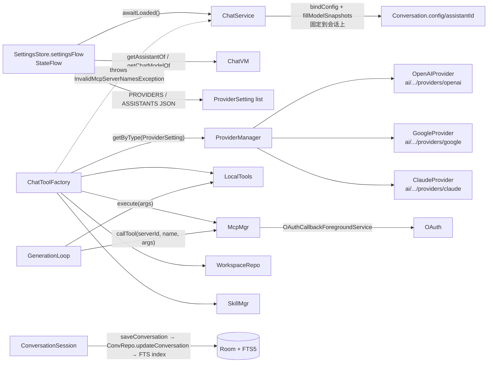
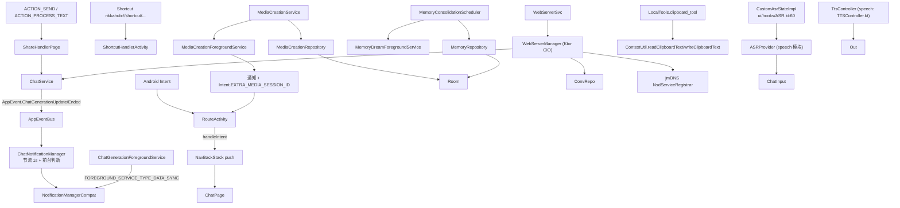

> 2026-10-20 状态：日期化记录。本文记录 2026-10-14 的判断，不描述当前实现。

# RikkaHub Android 客户端架构图与模块说明

调研日期：2026-10-14。调研对象：`/home/eafen405/projects/rikkahub` 本地 fork，提交 `0966502c feat(settings): 默认模型页改为 MD3 Expressive 风格`。研究仅基于该 fork 快照与 OurFairy 既有 `docs/research/*.md`，未运行构建或测试机验证。本文档不评价产品取舍，也不替 OurFairy 决定是否复用——这是事实层接线图。

## 0. 顶层结构速览

Gradle 多模块（见 `settings.gradle.kts:25-37`）。所有模块都是 Android Library 或 `:app`（Application）。模块依赖方向由各模块 `build.gradle.kts` 决定，下表给出最小引用集：

| 模块 | namespace | 主要职责（事实层） | 依赖模块 | 关键依赖库 |
| --- | --- | --- | --- | --- |
| `:app` | `me.rerere.rikkahub` | 入口、Compose UI、Koin 装配、Service、前台服务、文件/Skills、ChatService | 全部其他模块 | Room、OkHttp、Ktor、Retrofit、Compose、Navigation3、Koin、Paging3、Firebase |
| `:ai` | `me.rerere.ai` | 跨平台模型抽象 `Provider<T>`、流式分块 `StreamChunk`、`UIMessage`/`UIMessagePart` | `:common` | OkHttp、kotlinx.serialization、kotlinx.coroutines、kotlinx-datetime |
| `:common` | `me.rerere.common` | OkHttp/FloatingX/QuickJS/Commons-Text 等公共 API | — | OkHttp、kotlinx.serialization、QuickJS、FloatingX |
| `:search` | `me.rerere.search` | 12+ 个搜索 Provider 的统一 `SearchService` 抽象 | `:ai`、`:common` | OkHttp、kotlinx.serialization、Jsoup、QuickJS |
| `:speech` | `me.rerere.asr` | ASR Provider 抽象与多实现 | `:common` | OkHttp、kotlinx.serialization |
| `:oauth` | `me.rerere.oauth` | OAuth 回调 loopback server + AuthorizationLauncher | — | OkHttp、ktor-server-core/CIO |
| `:workspace` | `me.rerere.workspace` | proot 沙箱容器、rootfs、bind-mount、shell runner | — | xz（JNI 通过 `src/main/cpp`） |
| `:mediagen` | `me.rerere.mediagen` | 图像/视频生成 Provider（`MediaGenerationManager`） | `:common` | OkHttp、kotlinx.serialization |
| `:document` | `me.rerere.rikkahub.document` | 文档查看辅助库 | — | 仅 AppCompat/material |
| `:web` | `me.rerere.rikkahub.web` | Ktor server 引擎 + Web SPA 静态资源 + JWT 鉴权 | — | Ktor server 全家桶 |
| `:ui` | `me.rerere.ui` | 通用 Compose UI 组件（Ink 手写、ExifInterface） | — | Compose BOM、androidx.ink、jetbrains-markdown |
| `:material3` | `me.rerere.material3` | 嵌套 material-color-utilities + DynamicSchemeExt | — | Compose BOM |
| `:highlight` | `me.rerere.highlight` | 代码高亮 Compose 渲染 | — | Compose BOM |
| `:web-ui` | (Node) | Web SPA 前端（pnpm/Vite/React） | — | 构建产物被复制到 `:web/src/main/resources/static` |
| `:app:baselineprofile` | — | Macrobenchmark 生成 Baseline Profile | `:app` | — |

`build-logic/` 是 `includeBuild("build-logic")` 的 Gradle 约定插件（`settings.gradle.kts:3`），不产生二进制。

> 来源：`settings.gradle.kts:25-37`、`app/build.gradle.kts:309-326`、`ai/build.gradle.kts`、`common/build.gradle.kts:21-37`、`search/build.gradle.kts:33-44`、`workspace/build.gradle.kts`、`oauth/build.gradle.kts:13-22`、`web/build.gradle.kts:43-62`、`ui/build.gradle.kts:18-37`、`material3/build.gradle.kts:6-17`、`highlight/build.gradle.kts`、`mediagen/build.gradle.kts:18-26`、`speech/build.gradle.kts:23-28`、`web/build.gradle.kts:7-31`（构建步骤）。

## 1. Mermaid 架构图（模块分层 + 依赖方向）

```mermaid
graph TD
    %% ===== UI 层（Compose + Activity） =====
    subgraph UI["UI 层 · Compose"]
        RouteActivity["RouteActivity\napp/src/main/java/.../RouteActivity.kt:149\nNav3 NavDisplay · intent 路由"]
        ChatPage["ChatPage\napp/.../ui/pages/chat/ChatPage.kt"]
        ChatVM["ChatVM\napp/.../ui/pages/chat/ChatVM.kt:54"]
        ChatInput["ChatInput 组件\napp/.../ui/components/ai/ChatInput.kt"]
        Components["message/ai/nav/ui components\napp/.../ui/components/"]
        Hooks["hooks (TTS/ASR/ChatInputState)\napp/.../ui/hooks/"]
        Pages["pages/* (assistant/backup/...)\napp/.../ui/pages/"]
    end

    %% ===== 状态/会话层 =====
    subgraph STATE["会话状态层"]
        ChatService["ChatService\napp/.../service/ChatService.kt:184\n会话路由 + 队列 + 工具审批 + 标题/建议"]
        SessionMgr["ConversationSessionManager\napp/.../service/ConversationSessionManager.kt:18"]
        Session["ConversationSession\napp/.../service/ConversationSession.kt:23\nStateFlow<Conversation>"]
        MsgQueue["MessageQueue\napp/.../service/MessageQueue.kt:40\npre-dispatch 队列"]
        AppEventBus["AppEventBus\napp/.../data/event/AppEventBus.kt:7\nChatGenerationUpdate/Ended"]
        NotifMgr["ChatNotificationManager\napp/.../service/ChatNotificationManager.kt:37\n订阅 AppEventBus → 系统通知"]
    end

    %% ===== Service 层（Android 前台服务） =====
    subgraph SVC["Service 层"]
        ChatFGS["ChatGenerationForegroundService\napp/.../service/ChatGenerationForegroundService.kt:30\n保活生成 + Live Update 通知"]
        MediaFGS["MediaCreationForegroundService\napp/.../service/MediaCreationForegroundService.kt"]
        WebServerSvc["WebServerService\napp/.../service/WebServerService.kt:26"]
        MemDreamFGS["MemoryDreamForegroundService\napp/.../service/MemoryDreamForegroundService.kt"]
        MemoryScheduler["MemoryConsolidationScheduler\napp/.../data/ai/MemoryConsolidationScheduler.kt"]
    end

    %% ===== 持久层 =====
    subgraph PERSIST["持久层"]
        AppDB["AppDatabase (Room)\napp/.../data/db/AppDatabase.kt:79\n12 entities · v29"]
        AppDBFactory["AppDatabaseFactory\napp/.../data/db/AppDatabaseFactory.kt:17\nSQLite requery · jieba · FTS5"]
        DAOs["DAOs (Conversation/MessageNode/Memory/...)\napp/.../data/db/dao/*.kt"]
        MsgFts["MessageFtsManager (FTS5)\napp/.../data/db/fts/MessageFtsManager.kt"]
        ConvRepo["ConversationRepository\napp/.../data/repository/ConversationRepository.kt:30"]
        OtherRepos["MemoryRepo/WorkspaceRepo/FolderRepo/FavoriteRepo/...\napp/.../data/repository/"]
        SettingsStore["SettingsStore (DataStore+JSON)\napp/.../data/datastore/PreferencesStore.kt:91\nsettingsFlow : StateFlow<Settings>"]
        FilesMgr["FilesManager\napp/.../data/files/FilesManager.kt"]
        SkillMgr["SkillManager\napp/.../data/files/SkillManager.kt"]
        Backup["BackupManager/S3Sync/WebDavSync\napp/.../data/sync/"]
    end

    %% ===== AI / 工具层 =====
    subgraph AI["AI / 工具层"]
        GenerationLoop["GenerationLoop\napp/.../data/ai/GenerationLoop.kt:73\n流式 + 工具循环 + 重试"]
        ChatToolFactory["ChatToolFactory\napp/.../data/ai/tools/ChatToolFactory.kt:29\n装配工具集"]
        Transformers["transformers/*\napp/.../data/ai/transformers/\nInputMessage/Output/Transformer"]
        LocalTools["LocalTools\napp/.../data/ai/tools/local/LocalTools.kt\nAskUser/Calendar/Clipboard/JS/Schedule/ScreenTime/TTS/Time/Chart"]
        McpMgr["McpManager\napp/.../data/ai/mcp/McpManager.kt"]
        AiModule[":ai 模块\nai/src/main/java/me/rerere/ai/\nProvider<T> · StreamChunk · UIMessage"]
        ProviderMgr["ProviderManager\nai/.../provider/ProviderManager.kt:12\nOpenAI / Google / Claude"]
        Providers["providers/{openai,google,claude}\nai/.../provider/providers/\n流式 SSE/REST · schema 转换"]
    end

    %% ===== 平台/外部 =====
    subgraph EXTERNAL["外部依赖"]
        OkHttp["OkHttpClient (single)\napp/di/DataSourceModule.kt:158\nproxy · UA · logging"]
        Ktor["Ktor HttpClient\nDataSourceModule.kt:250 · S3Client"]
        Retrofit["Retrofit\nDataSourceModule.kt:285\napi.rikka-ai.com"]
        Room["Room KSP\napp/build.gradle.kts:317-319"]
        DataStore["DataStore Preferences\napp/build.gradle.kts:188"]
        Firebase["Firebase Analytics/Crashlytics\napp/build.gradle.kts:184-185"]
        Coil["Coil + OkHttp fetcher\nRouteActivity.kt:186-204"]
        WorkMgr["WorkManager + Koin factory\nRikkaHubApp.kt:79"]
        Server["HttpURL · jmDNS (NSD)\nWebServerManager · NsdServiceRegistrar"]
        ProotLib["libproot + libsimple (JNI)\nSQLiteConfiguration · workspace/src/main/cpp"]
    end

    %% ===== UI → 状态 =====
    RouteActivity --> ChatPage
    RouteActivity --> Pages
    ChatPage --> ChatVM
    ChatPage --> Components
    ChatPage --> Hooks
    ChatVM --> ChatService
    ChatVM --> SettingsStore
    ChatVM --> ConvRepo
    ChatVM --> FilesMgr
    Components --> ChatVM

    %% ===== 状态内部 =====
    ChatService --> SessionMgr
    ChatService --> MsgQueue
    ChatService --> AppEventBus
    ChatService --> GenerationLoop
    ChatService --> ChatToolFactory
    ChatService --> MemoryScheduler
    ChatService --> ConvRepo
    ChatService --> SettingsStore
    ChatService --> FilesMgr
    SessionMgr --> Session
    Session --> MsgQueue
    NotifMgr --> AppEventBus
    NotifMgr --> SettingsStore

    %% ===== Service =====
    ChatService -. acks generate .-> ChatFGS
    ChatFGS -. notification sharing .-> NotifMgr
    MediaFGS -. 通知媒体创作完成 .-> MediaCreationService
    MemoryScheduler -. onAppHidden/onTurnFinished .-> MemDreamFGS
    WebServerSvc --> OkHttp
    WebServerSvc --> Server
    MemDreamFGS --> MemoryScheduler

    %% ===== AI =====
    ChatToolFactory --> LocalTools
    ChatToolFactory --> McpMgr
    ChatToolFactory --> ConvRepo
    ChatToolFactory --> SkillMgr
    ChatToolFactory --> WorkspaceRepository
    GenerationLoop --> Transformers
    GenerationLoop --> AiModule
    GenerationLoop --> ProviderMgr
    ProviderMgr --> Providers
    Providers --> OkHttp

    %% ===== 持久 =====
    ConvRepo --> DAOs
    ConvRepo --> AppDB
    ConvRepo --> MsgFts
    ConvRepo --> FilesMgr
    AppDBFactory --> AppDB
    AppDB --> DAOs
    AppDB -. FTS5 virtual table .-> MsgFts
    OtherRepos --> DAOs
    Backup --> AppDB
    Backup --> SettingsStore

    %% ===== 数据流：外部 → 应用 =====
    OkHttp --> Providers
    Ktor --> Backup
    Retrofit --> RikkaHubAPI["RikkaHubAPI\napp/.../data/api/RikkaHubAPI.kt"]
    Server --> WebServerManager["WebServerManager\napp/.../web/WebServerManager.kt:38"]
    WebServerManager --> ChatService
    WebServerManager --> ConvRepo
    WebServerManager --> FilesMgr

    %% ===== 装配 =====
    Koin["Koin DI\napp/di/{App,DataSource,Repository,ViewModel}Module.kt\nsingle(viewModel)"]
    Koin -.装配.-> ChatService
    Koin -.装配.-> GenerationLoop
    Koin -.装配.-> OkHttp
    Koin -.装配.-> SettingsStore
    Koin -.装配.-> ConvRepo
    Koin -.装配.-> ChatVM
    RikkaHubApp["RikkaHubApp.onCreate\napp/src/main/java/me/rerere/rikkahub/RikkaHubApp.kt:62"] --> Koin
    RikkaHubApp --> WorkMgr
    RikkaHubApp --> Firebase
    RikkaHubApp --> ProotLib

    %% ===== UI 渲染回环 =====
    Session -.StateFlow<Conversation>.-> ChatVM
    ChatVM -.Compose collectAsStateWithLifecycle.-> ChatPage
    NotifMgr -.NotificationManagerCompat.-> SystemTray["Android System Tray"]
    ChatFGS -.FOREGROUND_SERVICE_TYPE_DATA_SYNC.-> AndroidOS["Android OS"]
    WebServerSvc -.FOREGROUND_SERVICE_TYPE_SPECIAL_USE.-> AndroidOS
    ProotLib --> Workspace
```



> 备注：图中虚线箭头表示“编排/触发”，实线箭头表示“直接类型引用或方法调用”。`AppEventBus` 是 `MutableSharedFlow<extraBufferCapacity=16>`（`AppEventBus.kt:8`），生成高频更新事件 `ChatGenerationUpdate` 和结束事件 `ChatGenerationEnded` 由 `ChatService` 发、由 `ChatNotificationManager` 消费（`ChatNotificationManager.kt:60-64`、`AppEvent.kt:11-25`）。

## 2. Mermaid 序列图：用户发消息 → AI 工具循环 → 持久化 → UI 回流

```mermaid
sequenceDiagram
    autonumber
    actor User
    participant ChatInput as ChatInput\n(ui/components/ai/ChatInput.kt)
    participant ChatVM as ChatVM\n(ui/pages/chat/ChatVM.kt:54)
    participant ChatService as ChatService\n(service/ChatService.kt:184)
    participant SManager as ConversationSessionManager\n(service/ConversationSessionManager.kt:18)
    participant Session as ConversationSession\n(service/ConversationSession.kt:23)
    participant MQueue as MessageQueue\n(service/MessageQueue.kt:40)
    participant GenLoop as GenerationLoop\n(data/ai/GenerationLoop.kt:73)
    participant ToolFactory as ChatToolFactory\n(data/ai/tools/ChatToolFactory.kt:29)
    participant Provider as Provider<T>\n(ai/provider/Provider.kt:17)
    participant OkHttp as OkHttp SSE\n(libs.okhttp.sse)
    participant ConvRepo as ConversationRepository\n(data/repository/ConversationRepository.kt:30)
    participant Room as Room/SQLite+requery+jieba+FTS5\n(data/db/AppDatabase.kt:79)
    participant FTS as MessageFtsManager\n(data/db/fts/MessageFtsManager.kt)
    participant EventBus as AppEventBus\n(data/event/AppEventBus.kt:7)
    participant NotifMgr as ChatNotificationManager\n(service/ChatNotificationManager.kt:37)
    participant ChatFGS as ChatGenerationForegroundService\n(service/ChatGenerationForegroundService.kt:30)
    participant SStore as SettingsStore\n(data/datastore/PreferencesStore.kt:91)

    User->>ChatInput: 点击发送
    ChatInput->>ChatVM: handleMessageSend(content)
    ChatVM->>ChatService: sendMessage(conversationId, content)
    ChatService->>SManager: getOrCreate(conversationId)
    SManager->>Session: ensureInitialized(loadConversation)
    Session->>ConvRepo: getConversationById(id)
    ConvRepo->>Room: SELECT conversationentity + message_node (paged)
    ConvRepo->>FTS: 命中后置入 conversation 视图
    Room-->>ConvRepo: Conversation
    ConvRepo-->>Session: boundConversation
    ChatService->>MQueue: enqueue(content, answer=true)
    ChatService->>SManager: dispatchNextQueuedMessage
    ChatService->>Session: launchGenerationJob (keepAliveInBackground=true)
    Session->>ChatFGS: acquire(generationId, conversationId)\n拉起前台服务
    ChatService->>SStore: awaitLoaded()\n固定 assistant + model 配置
    ChatService->>ToolFactory: createTools(settings, assistant, model, workspaceCwd)
    ToolFactory-->>ChatService: List<Tool> (memory/search/local/mcp/skill/workspace)
    ChatService->>GenLoop: generateText(messages, tools, transformers, memory)\nflowOn(Dispatchers.IO)
    loop 最多 256 步
        GenLoop->>Provider: streamText(providerSetting, messages, params)
        Provider->>OkHttp: SSE POST chat/completions
        OkHttp-->>Provider: StreamChunk (SseEvent)
        Provider-->>GenLoop: 累积为 attemptMessages\nattemptMessages 通过 StreamChunkHandler.handle
        GenLoop-->>ChatService: emit GenerationChunk.Messages
        ChatService->>Session: session.updateConversation(messages)
        Session-->>ChatVM: StateFlow<Conversation> tick
        ChatVM-->>ChatPage: Compose collectAsStateWithLifecycle
        ChatPage-->>User: 流式渲染
        ChatService->>EventBus: tryEmit(ChatGenerationUpdate)
        EventBus->>NotifMgr: 节流 1s 后 Live Update 通知
        GenLoop->>GenLoop: 扫描 tool_calls\n设置 Pending/Approved/Denied/Answered
        alt 有待执行工具
            GenLoop->>Provider: tool.execute(args) 本地执行或 McpManager.callTool
            Provider-->>GenLoop: tool.output
            GenLoop-->>ChatService: GenerationChunk.Messages (含 tool output)
        else 无工具或全部拒绝
            GenLoop-->>ChatService: 流结束 onCompletion
        end
    end
    ChatService->>Session: finishGeneration { save(conversation) }
    Session->>ConvRepo: updateConversation(updated)\n事务内删/插 message_node + FTS 索引
    ConvRepo->>Room: withTransaction { UPDATE conv; DELETE/INSERT nodes }
    ConvRepo->>FTS: indexConversation(updated)
    ChatService->>EventBus: emit(ChatGenerationEnded, contentPreview)
    EventBus->>NotifMgr: 取消 Live Update + 发送完成通知
    ChatService->>Session: setJob(null) → ChatFGS.release
    Session->>ChatFGS: release(generationId)\n最后一个生成完成时 stopService
    ChatService->>SManager: onSessionGenerationFinished → 推进队列
    Session-->>ChatVM: 状态稳定\ngenerationDoneFlow.emit
    ChatVM-->>User: 自动生成标题/建议/收藏提示
```

### 关键 hop 的源码定位

1. **输入**：`ChatPage.kt:223` 触发 `handleMessageSend(content)` → `ChatVM.kt:223-228` 委托给 `chatService.sendMessage(...)`。
2. **入队 + 会话初始化**：`ChatService.kt:386-394` `sendMessage()` 通过 `sessionManager.getOrCreate` 拿到/创建 `ConversationSession`（`ConversationSessionManager.kt:32-47`），并调用 `ensureInitialized` 从 `conversationRepo.getConversationById` 拉取。
3. **生成任务**：`ChatService.kt:428-489` `sendQueuedMessage()` 在 `appScope.launch` 协程里执行；进入前 `ChatService.kt:281-296` 调用 `ChatGenerationForegroundService.acquire(...)` 进入前台服务。
4. **工具集装配**：`ChatService.kt:677-696` → `ChatToolFactory.createTools`（`ChatToolFactory.kt:37-82`）。本地工具在 `data/ai/tools/local/LocalTools.kt`；MCP 工具在 `data/ai/tools/McpManager.getAllAvailableTools`；外部搜索来自 `:search` 模块。
5. **生成循环**：`ChatService.kt:698-754` → `GenerationLoop.generateText`（`GenerationLoop.kt:78-323`）。循环上限 `maxSteps = 256`（`GenerationLoop.kt:87`）；流式入口 `providerImpl.streamText`（`GenerationLoop.kt:420`）。
6. **Provider**：`ProviderManager.getProviderByType` 根据 `ProviderSetting` 子类型分派（`ProviderManager.kt:49-56`）；具体实现在 `ai/src/main/java/me/rerere/ai/provider/providers/{openai,google,claude}`。
7. **UI 回流**：每个 `GenerationChunk.Messages` 都会让 `ChatService.kt:740-752` 通过 `session.updateConversation` 推到 `ConversationSession.state`（`StateFlow`），由 `ChatVM.conversation`（`ChatVM.kt:66`）暴露给 Compose。
8. **通知侧链**：`ChatService.kt:748-750` 通过 `appEventBus.tryEmit(ChatGenerationUpdate)` → `ChatNotificationManager.handleGenerationUpdate`（`ChatNotificationManager.kt:65-81`）节流 1 秒（`ChatNotificationManager.kt:32`）后发送 Live Update。
9. **持久化**：`ConversationRepository.updateConversation` 在 `withTransaction` 内更新 `conversationentity`，删除/重建 `message_node` 行，并调用 `messageFtsManager.indexConversation` 重建 FTS5 索引（`ConversationRepository.kt:322-332`）。Room schema 在 `AppDatabase.kt:37-77`，迁移在 `data/db/migrations/`。
10. **生成收尾**：`onCompletion` 触发 `session.finishGeneration`（`ChatService.kt:723-737`、`ConversationSession.kt:72-84`），并 `appEventBus.emit(ChatGenerationEnded)`；后台且未打开时由通知管理器推送完成通知（`ChatNotificationManager.kt:83-100`）。

## 3. 关键接线点侧链

### 3.1 模型配置与工具执行侧链



- **配置加载**：`PreferencesStore.kt:91` 的 `SettingsStore` 是单例（`DataSourceModule.kt:53`）；`state` 初始为 `Settings.dummy()`（`PreferencesStore.kt:205`），启动后由 `init` 在 `Dispatchers.Default` 一次性读盘并 `normalized()` 规整（`PreferencesStore.kt:222-232`）；`awaitLoaded()` 阻塞直到 `!state.value.init`（`PreferencesStore.kt:211`）。
- **模型实例创建**：`ChatService.handleMessageComplete` 在 `ChatService.kt:643-647` 取 `assistant = settings.getAssistantOf(...)` 与 `model = settings.getChatModelOf(...)`；模型在 `data/datastore/SettingsExt.kt` 通过 `findModelById/findProvider` 定位（`ChatService.kt:873-876` 也有直接调用）；Provider 实例由 `ProviderManager.getProviderByType`（`ProviderManager.kt:49-56`）按 `OpenAI / Google / Claude` 路由。
- **工具循环**：见 `GenerationLoop.kt:98-323`。每步的语义：(a) 如果没有 resumable 工具就 `generateInternal`；(b) 收集 tool calls 并把需要审批的置 `ToolApprovalState.Pending`（`GenerationLoop.kt:174-204`）；(c) `execute` 已审批的工具，把结果回写到最后一条 `UIMessage` 的 `parts`（`GenerationLoop.kt:257-295`）；(d) 重复直到没有 tool call 或超过 256 步。
- **会话存储与同步**：`ConversationSession.state` 是 `StateFlow<Conversation>`（`ConversationSession.kt:32`），是内存权威态；落库通过 `ChatService.saveConversation`（`ChatService.kt:1239-1259`）→ `ConversationRepository.updateConversation`（事务：`ConversationRepository.kt:322-332`）→ `MessageFtsManager.indexConversation`（`ConversationRepository.kt:331`）。FTS5 表在 `AppDatabaseFactory.kt:45-56` 的 `onOpen` 回调里 `CREATE VIRTUAL TABLE message_fts USING fts5(text, node_id, message_id, conversation_id, title, update_at, tokenize='simple')`；分词使用 `libsimple`（requery SQLite 扩展，`SQLiteConfiguration.kt:8-15`）。

### 3.2 通知/外部触发侧链



入口位置：
- **通知 / 外部 Intent**：`RouteActivity.kt:222-247` 的 `handleIntent` 处理 `ACTION_TRANSLATE` / `ACTION_MEDIA_CREATION` / `ACTION_SEND` / `ACTION_PROCESS_TEXT` / `rikkahub://shortcut/...`（manifest 在 `AndroidManifest.xml:108-141`）。
- **通知产生**：`ChatService.kt:730-737` 在 `onCompletion` 发 `ChatGenerationEnded`；`ChatService.kt:748-750` 在每个 chunk 发 `ChatGenerationUpdate`；消费方在 `ChatNotificationManager.kt:51-100`。
- **通知通道**：`RikkaHubApp.createNotificationChannel` 在 `RikkaHubApp.kt:252-295` 注册 5 条通道：`chat_completed` (HIGH)、`chat_live_update` (LOW)、`web_server` (LOW)、`media_creation` (DEFAULT)、`memory_dream` (LOW)。Live Update 通知 ID 与 `ChatGenerationForegroundService.NOTIFICATION_ID` 共享以避免重复（`ChatNotificationManager.kt:115`）。
- **前台服务保活**：`ChatGenerationForegroundService`（`AndroidManifest.xml:126`、实现 `service/ChatGenerationForegroundService.kt:30`）类型 `dataSync`；`MediaCreationForegroundService` 类型同样 `dataSync`（`AndroidManifest.xml:131`）；`WebServerService` 类型 `specialUse`（`AndroidManifest.xml:136-142`）；`MemoryDreamForegroundService` 类型 `dataSync`（`AndroidManifest.xml:144`）。
- **剪贴板**：模型工具 `clipboard_tool`（`data/ai/tools/local/ClipboardTool.kt:17-70`），通过 `ContextUtil.readClipboardText/writeClipboardText`；UI 端 Compose `LocalClipboardManager` 用于导出/导入按钮（`ui/pages/imggen/ImgGenPage.kt:548`、`ui/pages/setting/SettingWebPage.kt:79`）。
- **语音输入**：`ui/hooks/ASR.kt:60-130` 包装 `:speech` 模块的 `ASRController`，由 `rememberCustomAsrState` 注入 `LocalASRState`；ASR 实现位于 `speech/src/main/java/me/rerere/asr/providers/{DashScope,Volcengine,MiMo,Step,OpenAIRealtime}`。
- **语音输出**：`ui/hooks/TTS.kt:36-130` 注入 `LocalTTSState`，由 `TTSController` 订阅 `AppEvent.Speak`（`RouteActivity.kt:271-280`）。
- **文件导入**：`ActivityResultContracts.OpenDocument/OpenDocumentTree` 分散在各页（如 `ui/pages/extensions/workspace/WorkspaceDetailPage.kt:118`、`ui/pages/extensions/skills/SkillsPage.kt:98`、`ui/pages/assistant/detail/AssistantImporter.kt:73/99`、`ui/pages/backup/tabs/ImportExportTab.kt:102`），最终落到 `FilesManager`（`data/files/FilesManager.kt`）复制到应用内部存储并生成 `UIMessagePart.Image/Audio/Video/Document`。
- **Web 服务器入口**：`RikkaHubApp.startWebServerIfEnabled`（`RikkaHubApp.kt:214-250`）在设置 `webServerEnabled=true` 且权限允许时启动 `WebServerService`；`WebServerManager.start`（`web/WebServerManager.kt:53-`）通过 `:web` 模块 `startWebServer` 启动 Ktor CIO，mDNS 注册用 `NsdServiceRegistrar`（`web/NsdServiceRegistrar.kt`）。

## 4. 外部依赖清单

| 依赖 | Gradle 坐标（来自 `libs.versions.toml`） | 在哪几个文件用 | 起什么作用 |
| --- | --- | --- | --- |
| Room | `androidx.room.runtime`、`androidx.room.ktx`、`androidx.room.paging`、`androidx.room.compiler`（KSP）`app/build.gradle.kts:317-323` | `AppDatabase.kt:79`、`*Entity.kt`、`*DAO.kt`、`AppDatabaseFactory.kt:17`、`ConversationRepository.kt:30-332`、`MessageFtsManager.kt`、`DatabaseMigrationTracker.kt` | 12 个实体的本地数据库，`message_node` 通过外键级联删除；FTS5 virtual table；requery SQLite + `libsimple` 自定义扩展 |
| OkHttp | `com.squareup.okhttp3:okhttp` + `okhttp-sse` + `logging`（`app/build.gradle.kts:206-208`） | `DataSourceModule.kt:158-230`（单一 OkHttpClient，proxy/UA/语言/logging 拦截器）；`ai/src/main/java/me/rerere/ai/provider/providers/{openai,google,claude}/*StreamDecoder` 解析 SSE；`speech/src/main/java/me/rerere/asr/providers/*ASRController` 走 ASR；`data/sync/s3/S3Client.kt` 走 S3 | 所有 Provider 调用、AI request logging、ASR、S3 上传下载；OkHttpClient 注入到 Coil 的 fetcher（`RouteActivity.kt:188-203`） |
| Ktor Client | `io.ktor:ktor-client-core` + `ktor-client-okhttp` + `content-negotiation` + `serialization-kotlinx-json`（`app/build.gradle.kts:210-214`） | `DataSourceModule.kt:250-263`（单例 `HttpClient(OkHttp)`）；`data/sync/s3/S3Client.kt`（请求上传）；`oauth` 模块 `OAuthHttpClient.kt` + `OAuthLoopbackCallbackServer.kt`（Ktor server） | S3 同步和 OAuth loopback 服务器；OAuth 模块复用了 Ktor server CIO |
| Ktor Server | `:web` 模块 `web/build.gradle.kts:43-62`（`ktor-server-core`、`cio`、`auth/jwt`、`content-negotiation`、`cors`、`compression`、`sse`、`status-pages`） | `web/src/main/java/me/rerere/rikkahub/web/Entry.kt:23-42`；`web/WebServerManager.kt`、`web/WebApiModule.kt`、`web/routes/*`（ConversationRoutes/EventsRoutes/FilesRoutes/SettingsRoutes/FolderRoutes/...） | 本地 Web SPA 服务的运行时；JWT 鉴权；SSE 端点推送事件 |
| Retrofit | `com.squareup.retrofit2:retrofit` + `retrofit-kotlinx-serialization-converter`（`app/build.gradle.kts:207-208`） | `DataSourceModule.kt:285-294`（baseUrl `https://api.rikka-ai.com`）；`data/api/SponsorAPI.kt`、`RikkaHubAPI.kt`（后者当前是空接口，但 DI 已经准备好） | 远程厂商 API（赞助提醒等）；目前 `RikkaHubAPI` 为空 |
| kotlinx-serialization-json | `libs.kotlinx.serialization.json`（`app/build.gradle.kts:226`） | `utils/JsonInstant.kt`、`MessageNodeEntity.messages`、`ConversationEntity.chatSuggestions/modeInjectionIds/lorebookIds/config`、`SettingsStore` JSON 持久化、`PreferencesStore.putSettings`、`MediaCreationRepository` JSON 字段 | 整个应用的 JSON 序列化 |
| kotlinx-coroutines / Flow | `libs.kotlinx.coroutines.core` + `Dispatchers` | 全部 `service/`、`data/ai/GenerationLoop.kt`、`ChatVM.kt`、`ConversationSessionManager.kt`、`MessageQueue.kt`、`AppEventBus.kt` | 单例 `AppScope`（`RikkaHubApp.kt:304-310`）是 `SupervisorJob() + Dispatchers.Main + CoroutineExceptionHandler`；`ConversationSession.setJob` 通过 `invokeOnCompletion` 串接生成-通知-队列派发 |
| DataStore (Preferences) | `androidx.datastore:datastore-preferences`（`app/build.gradle.kts:188`） | `PreferencesStore.kt:62-83`（带 `ReplaceFileCorruptionHandler`、4 个版本 migration）；`DataSourceModule.kt:53`（单例） | 整份 `Settings` 的 JSON 持久化（`preferences.putSettings`） |
| Paging 3 | `androidx.paging:runtime`、`paging-compose`（`app/build.gradle.kts:325-326`） | `ConversationRepository.getConversationsOfAssistantPaging` 等 6 处 `Pager(PagingConfig(pageSize=20, initialLoadSize=40))`（`ConversationRepository.kt:67-78`、`80-99`、`101-120`、`248-259`、`271-288`）；`ui/pages/chat/ChatDrawer.kt` 订阅 | 历史会话、搜索结果、文件夹内会话的分页加载 |
| Firebase | `firebase-bom`、`firebase-analytics`、`firebase-crashlytics`（`app/build.gradle.kts:183-185`） | `AppModule.kt:54-60`（`Firebase.crashlytics` + `Firebase.analytics` 注入）；`ChatVM.kt:225/232/275/284/292` 上报 `ai_send_message/ai_edit_message/ai_regenerate_at_message/ai_tool_approval/ai_tool_answer`；`utils/CrashHandler.kt` 安装全局异常处理 | 分析事件和崩溃日志 |
| Coil | `coil-compose`、`coil-gif`、`coil-okhttp`、`coil-svg`、`coil-cache-control`（`app/build.gradle.kts:212-225`） | `RouteActivity.kt:186-204`（全局 ImageLoader，OkHttp fetcher 复用注入的 `OkHttpClient`，启用 Gif/SVG decoder） | 图片加载（消息附件、头像） |
| WorkManager + Koin | `androidx.work:work-runtime-ktx`（`app/build.gradle.kts:160`）；`koin-androidx-workmanager`（`app/build.gradle.kts:204`） | `RikkaHubApp.kt:79` `workManagerFactory()`；`androidx.startup.InitializationProvider` 在 `AndroidManifest.xml:171-178` 中禁用默认 `WorkManagerInitializer` 让 Koin 控制 | 把 WorkManager 与 Koin 关联，便于 Worker 注入 |
| Navigation 3 | `androidx.navigation3:runtime` + `ui` + `lifecycle-viewmodel-navigation3` + `material3-adaptive-navigation3`（`app/build.gradle.kts:177-180`） | `RouteActivity.AppRoutes` `NavDisplay(backStack, entryProvider { ... })`（`RouteActivity.kt:325-577`） | 单 Activity 多 Compose 目的地 |
| jmDNS | `jmDNS`（`app/build.gradle.kts:264`） | `web/NsdServiceRegistrar.kt`；`WebServerManager.kt:48` | 在本地网络用 mDNS/Bonjour 注册 `_rikkahub._tcp` 服务名 |
| SLF4J Android binding | `slf4j-api`、`slf4j-android`（`app/build.gradle.kts:267-268`） | 通过 Ktor 依赖传递；将 Ktor/SLF4J 日志路由到 logcat | Ktor/OkHttp 桥接 |
| requery SQLite | `sqlite-android`（`app/build.gradle.kts:271`） | `SQLiteConfiguration.kt:8-15`、`AppDatabaseFactory.kt:59`（`RequerySQLiteOpenHelperFactory`）；加载 `nativeLibraryDir/libsimple` 作为 `customExtensions` | 加载 jieba 分词扩展，FTS5 用 `tokenize='simple'` |
| proot + jniLibs | `jniLibs/` | `workspace/src/main/cpp/CMakeLists.txt`；`ProotShellRunner.kt` 通过 `nativeLibraryDir` 加载 | workspace 容器内 shell 执行 |
| QuickJS | `io.github.dokar3:quickjs-kt-android`（`app/build.gradle.kts:156`、`search/build.gradle.kts`、`common/build.gradle.kts`） | `CustomJsSearchService.kt`、`DocumentAsPromptTransformer.kt`、Pebble 模板加载器旁路 | 在沙箱里跑用户搜索脚本/模板预处理 |
| mcp-kotlin-sdk | `io.modelcontextprotocol:kotlin-sdk`（`app/build.gradle.kts:262`） | `data/ai/mcp/McpManager.kt`、`McpSessionRegistry.kt`、`McpOAuthCoordinator.kt` | Model Context Protocol 客户端，连接到外部 MCP 服务器 |
| Termux terminal view | `termux/terminal-view`（`app/build.gradle.kts:163`） | `ui/pages/extensions/workspace/WorkspaceTerminalSession.kt` | workspace 终端 UI |
| Pebble | `pebble`（`app/build.gradle.kts:217`） | `DataSourceModule.kt:65-77`（`PebbleEngine`，按 `AssistantTemplateLoader` 加载助手提示模板；设置变更时通过 `engine.templateCache.invalidateAll()` 失效缓存） | 助手系统提示词模板 |
| jlatexmath | `jlatexmath`（`app/build.gradle.kts:259-261`） | Compose 渲染 LaTeX 公式 | 数学公式 |
| zxing + quickie + barcode-scanning | `app/build.gradle.kts:243-247` | 二维码扫描页 | QR 扫码登录/分享 |

## 5. 模块说明（深模块视角）

每条说明按“职责 / 隐藏的复杂性 / 对调用方暴露的接口 / 与其他模块的依赖”描述。仅记录事实，不评价取舍。

### 5.1 `:ai` 模块（`me.rerere.ai`）

- **职责**：与具体协议无关的模型抽象：`Provider<T : ProviderSetting>`、`Model`、`MessageRole`、`Tool`、`UIMessage/UIMessagePart`（`ai/src/main/java/me/rerere/ai/{core,provider,ui}`）。同时把 SSE 分块（`StreamChunk`、`StreamChunkHandler`、`provider/stream/SseEvent`）抽到独立目录。
- **隐藏的复杂性**：把不同协议（OpenAI ChatCompletions / Responses、Claude、Google / Vertex）的 schema 收敛到同一份 `StreamChunk` 与 `UIMessage`；`UIMessage` 内含 `modelSnapshot` 解决“模型被删除后历史消息仍显示原模型名”的问题（`UIMessage.kt:43`）；`StreamChunkHandler` 处理 `streamText` 重试时不让重试响应追加到旧消息尾部（`GenerationLoop.kt:401-414` 的注释解释了 `responseBaseMessages`）。
- **对外接口**：`Provider<T>` 的 `streamText/generateText/listModels/generateImage/editImage`（`Provider.kt:17-56`）；`UIMessage.system/user/assistant`、`UIMessage.toText/summaryAsText`、`UIMessagePart.Tool.{isPending,isExecuted,approvalState}`、`ToolApprovalState.{Auto,Pending,Approved,Denied,Answered}` 与扩展函数 `canResumeToolExecution`、`finishPendingTools`、`isEmptyInputMessage`。
- **依赖**：`:common`（传递 OkHttp、kotlinx-serialization、kotlinx-coroutines、kotlinx-datetime）；被 `:search`、`:app` 直接依赖；被 `:mediagen`、`:speech` 间接依赖（通过 `:common`）。

### 5.2 `:search` 模块（`me.rerere.search`）

- **职责**：12+ 搜索 Provider 的统一接入点（`SearchService.getService(options)`）；在 `:app` 中由 `ChatToolFactory.createSearchTools`（`ChatToolFactory.kt:46-48`）按需打包成 `Tool(name="search_web")`。
- **隐藏的复杂性**：每个 Provider 自带独立的请求 schema，结果通过 `createSearchTools` 内的 JSON 序列化统一格式化为 `items[].{id,index,title,url,publishedDate,highlights,text}` + `images[]`；自定义脚本由 QuickJS 在沙箱内执行（`CustomJsSearchService`）。
- **对外接口**：`SearchService.search(params, commonOptions, serviceOptions): Result<...>`；`SearchService.getService(options): SearchService`；`SearchServiceOptions.DEFAULT`。
- **依赖**：`:ai`（消费 `Tool`/`UIMessagePart`）、`:common`、Jsoup、QuickJS；被 `:app` 引用。

### 5.3 `:common` 模块（`me.rerere.common`）

- **职责**：跨模块共享 API：`http.AcceptLanguageBuilder`、OkHttp、kotlinx-serialization、kotlinx-coroutines、kotlinx-datetime、Apache Commons Text、QuickJS、FloatingX（悬浮窗）。
- **隐藏的复杂性**：FloatingX 是悬浮窗库（API 暴露）。
- **对外接口**：直接 `api(...)` 暴露的依赖。
- **依赖**：无项目内依赖；被 `:ai`、`:search`、`:speech`、`:mediagen`、`:oauth`、`:app` 直接依赖。

### 5.4 `:workspace` 模块（`me.rerere.workspace`）

- **职责**：提供 proot 容器运行 shell：rootfs 安装（`RootfsInstaller`）、容器构建（`WorkspaceManager`）、绑定挂载（`WorkspaceBindMount`）、shell 执行（`ProotShellRunner`）、进程 patch（`RootfsPatcher`）。
- **隐藏的复杂性**：CMake 编译 proot 原生库，绑定挂载表同时给 PRoot `-b` 参数和文件工具路径解析使用（`RepositoryModule.kt:58-77` 注释）；`/skills`、`/builtin_skills`、`/tool_outputs`、`/upload` 4 个固定挂载。
- **对外接口**：`WorkspaceManager(baseDir, shellRunner, bindMounts)`、`WorkspaceStorageArea`、`WorkspaceShellStatus`、`ProotShellRunner(nativeLibraryDir)`、`RootfsInstaller(context)`。
- **依赖**：仅 Android 基础库 + xz；被 `:app` 在 `RepositoryModule.kt:53-77` 装配。

### 5.5 `:speech` 模块（`me.rerere.asr`）

- **职责**：ASR Provider 抽象与实现：`ASRController`、`ASRProviderSetting`（OpenAIRealtime/DashScope/Volcengine/MiMo/Step）。
- **隐藏的复杂性**：每个 Provider 自己管理音频采集和分片上传（`ASRVoiceTurn`）；不依赖统一 TTS。
- **对外接口**：`ASRController.start/stop/dispose`；`ASRState` 流；`rememberCustomAsrState` 在 `:app` 的 `ui/hooks/ASR.kt:36` 处包装。
- **依赖**：`:common`；被 `:app` 引用。

### 5.6 `:oauth` 模块（`me.rerere.oauth`）

- **职责**：通用 OAuth 助手：`OAuthAuthorizationLauncher`（通过 `androidx.browser` CustomTabs）、`OAuthLoopbackCallbackServer`（Ktor CIO 起一个本地回环端口接收回调）、`OAuthHttpClient`、`OAuthCallbackForegroundService`（manifest 声明在 `AndroidManifest.xml` 配合）。
- **对外接口**：单一抽象 `OAuthAuthorizationLauncher`，被 `:app` 的 `McpOAuthCoordinator`、`McpOAuthDiscoveryClient` 直接使用。
- **依赖**：OkHttp、ktor-server-core/CIO；被 `:app` 引用。

### 5.7 `:mediagen` 模块（`me.rerere.mediagen`）

- **职责**：图像/视频生成 Provider 抽象与 `MediaGenerationManager`（类似 `:ai` 的 `ProviderManager`）。
- **对外接口**：`MediaGenerationManager(client)`、`MediaGenerationProviderSetting`、`MediaGenerationTask/Status/Output/Model`。
- **依赖**：`:common`；被 `:app` 在 `DataSourceModule.kt:281-283` 单例装配；`MediaCreationService`（`service/MediaCreationService.kt:86`）使用。

### 5.8 `:document` 模块（`me.rerere.rikkahub.document`）

- **职责**：文档查看辅助（最薄一层）。
- **对外接口**：仅 `:app` 使用。

### 5.9 `:web` 模块（`me.rerere.rikkahub.web`）

- **职责**：本地 Ktor server：SPA 静态资源（来自 `web-ui` 构建输出）+ Web API（`routes/`）+ JWT 鉴权 + SSE 推送。
- **隐藏的复杂性**：`web/build.gradle.kts:7-31` 通过 `buildWebUi` Exec 任务把 `web-ui/` 子项目（pnpm/Vite）产物复制到 `src/main/resources/static`；`:app` 的 `RikkaHubApp.startWebServerIfEnabled` 在启动时按设置决定是否拉起。
- **对外接口**：`startWebServer(port, host, module)` 内部 `EmbeddedServer<CIOApplicationEngine, *>`；`configureWebApi(...)` 挂载所有 routes。
- **依赖**：被 `:app` 通过 `WebServerManager`（`web/WebServerManager.kt`）消费。

### 5.10 `:ui` 模块（`me.rerere.ui`）

- **职责**：通用 Compose UI 组件（Ink 手写、ExifInterface）。模块内不含 chat 业务。
- **对外接口**：被 `:app` `ui/components/`、`ui/modifier/` 使用。

### 5.11 `:material3` 模块（`me.rerere.material3`）

- **职责**：内嵌 `material-color-utilities` 源码 + `DynamicSchemeExt`（`DynamicSchemeExt.kt`），补 Compose M3 动态色不足。
- **对外接口**：`DynamicSchemeExt`；被 `:app` 主题层使用。

### 5.12 `:highlight` 模块（`me.rerere.highlight`）

- **职责**：代码高亮 Compose 渲染（`Highlighter.kt`、`HighlightToken.kt`、`HighlightStyle.kt`）。
- **对外接口**：`Highlighter`；被 `:app` 在 `ui/components/message/` 中用于 Markdown 代码块渲染。

### 5.13 `:app` 模块（`me.rerere.rikkahub`）

#### 5.13.1 数据层

- **`AppDatabase` + DAOs**：12 个实体（`AppDatabase.kt:37-51`），DAO 在 `data/db/dao/`；`MessageNodeEntity` 通过外键 CASCADE 跟随会话删除（`MessageNodeEntity.kt:12-21`）。Room schema 导出到 `app/schemas/`（`app/build.gradle.kts:106`）。
- **`ConversationRepository`**：隐藏的分页加载（`PagingConfig(pageSize=20, initialLoadSize=40)`）、SQLiteBlobTooBigException 重试（`ConversationRepository.kt:491-500`）、JSON 编解码（`JsonInstant`）。对外暴露 `getConversationById/getConversationFlow/insertConversation/updateConversation/deleteConversation/searchMessages/rebuildAllIndexes`。
- **`MessageFtsManager`**：管理 `message_fts` virtual table（`AppDatabaseFactory.kt:45-56` 的 `CREATE VIRTUAL TABLE IF NOT EXISTS`），索引文本+节点 ID+消息 ID+会话 ID+标题+更新时间。
- **`SettingsStore`**：单例 `DataStore<Preferences>` + 内存 `MutableStateFlow<Settings>`；`awaitLoaded()` 阻塞到磁盘读出。`update(fn)` 通过 `synchronized(stateLock)` + `persistMutex` 保证连续修改只写最新一份（`PreferencesStore.kt:249-279`）。`corruptionHandler` 把损坏文件备份成 `*.corrupt-{ts}` 后重建。
- **`FilesManager`**：管理聊天文件、managed files、Skill 文件、媒体创作文件、上传文件（`data/files/FilesManager.kt`）。`createChatFilesByContents` 把 URI 列表复制到内部存储（`ChatPage.kt:155`）。
- **`SkillManager` / `WorkspaceManager` / `MediaCreationRepository` / `MemoryRepository` / `WorkspaceRepository`**：分别在 `data/files/`、`workspace/`、`data/repository/`、`data/ai/`；`ChatToolFactory.createTools` 引用 `memoryRepository / workspaceRepository / skillManager` 来决定工具可见性。

#### 5.13.2 AI 编排层

- **`ChatService`**：唯一一个面向 UI 的“聊天编排”入口。包含 `sendMessage`、`regenerateAtMessage`、`handleToolApproval`、`handleMessageComplete`、`generateTitle`、`generateSuggestion`、`compressConversation`、`saveConversation`、`translateMessage`、`editMessage`、`forkConversationAtMessage`、`moveConversationToFolder`、`moveConversationToAssistant`、`deleteFolder`、`toggleConversationPinned`（`ChatService.kt` 全文 1543 行）。所有动作都委托给 `ConversationSessionManager + ConversationSession` 的内存态，并以 `saveConversation` 落库。
- **`ConversationSessionManager`**：抽象会话的引用计数与懒回收。`acquire/release`（`ConversationSessionManager.kt:49-55`）、`withSession`、`removeIfIdle`（`ConversationSessionManager.kt:74-83`）。空闲超时 5s 回收（`ConversationSession.kt:21`）。
- **`ConversationSession`**：单一会话的内存真相：`_state: StateFlow<Conversation>`、`messageQueue`、`generationJob: StateFlow<Job?>`、`processingStatus: MutableStateFlow<String?>`；引用计数（`refCount: AtomicInteger`）控制是否进入空闲回收（`ConversationSession.kt:91-104`）。
- **`MessageQueue`**：发送前排队；`enqueue/takeNext/beginEdit/finishEdit/pause/resume`（`MessageQueue.kt:40-118`）。
- **`GenerationLoop`**：见 3.1；唯一对 `Provider.streamText` 的调用方。
- **`ChatToolFactory`**：每次生成时构建工具集（`ChatToolFactory.kt:37-82`）：记忆工具、外部搜索、本地工具、最近聊天引用、workspace shell（仅在 `WorkspaceShellStatus.READY`）、启用的 Skills、MCP（命名规范 `mcp__{server}__{tool}`）。MCP 名称含非法字符时抛 `InvalidMcpServerNamesException`，由 `ChatService.kt:684-696` 翻译成错误提示。
- **`LocalTools`**（`data/ai/tools/local/`）：`AskUserTool`、`CalendarTool`、`ChartDisplayTool`、`ClipboardTool`、`JavascriptTool`、`ScreenTimeTool`、`TextToSpeechTool`、`TimeInfoTool`。
- **`transformers/*`**：输入 5 个 + 输出 3 个（`ChatService.kt:166-182`），其中输入包含 `WorkspaceReminderTransformer`（每次生成临时构造，依赖 `workspaceRepository`）。`TemplateTransformer` 来自 Pebble 引擎（`DataSourceModule.kt:65-77`）。

#### 5.13.3 状态/事件/通知

- **`AppEventBus`**：`MutableSharedFlow<extraBufferCapacity=16>`（`AppEventBus.kt:8`），事件类型 `Speak / OpenUsageAccessSettings / ChatGenerationUpdate / ChatGenerationEnded`（`AppEvent.kt`）。`tryEmit` 不挂起（生成高频更新用）。
- **`ChatNotificationManager`**：订阅 `AppEventBus`；按 `ProcessLifecycleOwner` 维护 `isForeground`，只在后台时发系统通知；Live Update 节流 1 秒（`ChatNotificationManager.kt:32`）；与 `ChatGenerationForegroundService` 共享通知 ID（`ChatNotificationManager.kt:115`）。
- **`ChatGenerationForegroundService`**：以 `FOREGROUND_SERVICE_TYPE_DATA_SYNC` 拉起，保持进程在流式生成期间留在前台；多代并发用 `linkedMapOf<generationId, conversationId>` 计数（`ChatGenerationForegroundService.kt:66`）；超时通过 `onTimeout` 主动停止生成（`ChatGenerationForegroundService.kt:91-103`）。

#### 5.13.4 UI 层

- **`RouteActivity`**：单 Activity，`setContent { RikkahubTheme { AppRoutes() } }`；`NavDisplay` + `NavBackStack`（`RouteActivity.kt:325-577`）。所有 destination 是 `sealed interface Screen : NavKey`（`RouteActivity.kt:627-792`）。intent 通过 `handleIntent` 处理。
- **`ChatPage` + `ChatVM`**：Compose → ViewModel → ChatService。`ChatVM.conversation: StateFlow<Conversation>` 直接代理 `ChatService.getConversationFlow`（`ChatVM.kt:66`）；`processingStatus / conversationJob / conversationJobs / messageQueue` 同样代理。
- **`ChatDrawer` + `HistoryPage` 等**：用 Paging 加载历史。

#### 5.13.5 Service 层

- **`ChatGenerationForegroundService`**、**`MediaCreationForegroundService`**、**`WebServerService`**、**`MemoryDreamForegroundService`**：分别对应 `dataSync / dataSync / specialUse / dataSync` 前台服务类型，manifest 声明在 `AndroidManifest.xml:126-145`。
- **`MediaCreationService`**：媒体创作生成（图像/视频），进度写入 `media_creation_*` 表；前台服务通知携带 `EXTRA_MEDIA_SESSION_ID` 让点击直接跳到对应 `Screen.MediaCreation`（`RouteActivity.kt:258-261`）。
- **`WebServerService`**：启动 `WebServerManager`；状态由 `ProcessLifecycleOwner` 决定何时 `stopSelf`。
- **`MemoryDreamForegroundService`**：`MemoryConsolidationScheduler` 触发；`RikkaHubApp.resumeMemoryConsolidation`（`RikkaHubApp.kt:131-145`）注册 `ON_STOP` 后立即开始整理（说明见注释“应用被切走后进程随时可能被冻结”）。

#### 5.13.6 装配层

- **Koin 模块**：`app/di/{AppModule, DataSourceModule, RepositoryModule, ViewModelModule}` 分别负责 app/dataSource/repository/viewModel 单例与 viewModel 构造。`RikkaHubApp.onCreate`（`RikkaHubApp.kt:62-119`）的顺序是：先 `applyPendingRestore` → `startKoin` → 创建通知通道 → 设 cursor window → 装 CrashHandler → 清临时文件 → 校验 workspace 完整性 → 同步 managed files → 抽内置 skills → 启动 WebServer（若启用）→ 续跑媒体创作/记忆整理 → 增启动次数。
- **DI 关键单例**：`OkHttpClient`、`ProviderManager`、`GenerationLoop`、`ChatToolFactory`、`ChatService`、`ChatNotificationManager(createdAtStart=true)`、`McpManager`、`SettingsStore`、`AppDatabase`、`AppEventBus`、`WorkManagerFactory`、`Firebase.analytics/crashlytics`、`UpdateChecker`、`WebServerManager`、`MediaCreationService`、`MemoryConsolidationScheduler`。

#### 5.13.7 外部集成

- **Web Server**：本地 Ktor 监听 `0.0.0.0:8080`（或回环），mDNS 注册；`routes/` 暴露会话、文件夹、文件、设置、AI 图标、事件流端点（`web/routes/`）。
- **备份同步**：`BackupManager`（`data/sync/BackupManager.kt`）+ `S3Sync`（Ktor HttpClient）+ `WebDavSync`（OkHttp）+ `PendingRestore`；启动前由 `applyPendingRestore` 提前落盘再让 Koin 装配（`RikkaHubApp.kt:65-75`）。
- **更新检查**：`UpdateChecker` 由 `ChatVM` 订阅（`ChatVM.kt:202-215`）。

## 6. 与前序研究（#6 / `frontend-pruning`）的关系

- 本文档只画“模块间的连接与运行时数据流”，**不重复**模块/能力剪枝分析。
- 已经在前序研究中写明的接线点（如通知、消息存储、模型抽象）这里仅给出源码定位，便于读者从“事实层接线图”直接回到代码；不替前序研究下结论。
- 前序研究 `docs/research/android-notifications.md` 描述的 `ChatNotificationManager` 行为在本文件中以源码行号复述（`ChatNotificationManager.kt:32, 51-100` 等），未发现新的接入；如有差异以后者为准。
- 前序研究 `docs/research/message-model.md` 描述的 dsh 消息模型（结构、内容块、事件日志）是 dsh 视角，本文件描述的是 rikkahub 视角的 `UIMessage` / `MessageNode`（`ai/src/main/java/me/rerere/ai/ui/Message.kt`、`app/src/main/java/me/rerere/rikkahub/data/db/entity/MessageNodeEntity.kt`）；两套模型不一一对应：rikkahub 的 `UIMessage` 是当前轮次的扁平列表，分支存储在 `MessageNode.messages`；dsh 的 `Message` 是不可变 + `source` 标记。
- 前序研究 `docs/research/session-owner-execution.md`、`dsh-sandbox-reuse.md`、`proactive-agents.md` 都不直接涉及 rikkahub Android 客户端代码；本文件未引用其结论。

## 7. 调研方法与局限

- 仅阅读源码：`/home/eafen405/projects/rikkahub` 当前 fork（commit `0966502c`）；未运行 Gradle 任务、未编译、未在设备上验证；未引用网络资源。
- 引用方式：行号以本仓库当前快照为准；fork 与上游是否同步未核实。
- 仅看 Kotlin 源码；未扫描 jniLibs 二进制、未读 KSP/Room 自动生成代码。
- 未覆盖的接缝：依赖注入的运行时分层（每个 `single`/`viewModel` 的真实构造栈在第一帧才落地）；`web-ui` 子项目的 Vite/React 运行时接线；baselineprofile 模块；`app/schemas` 自动生成内容。
- 已知差异：fork `0966502c` 与上游 `rikkahub/rikkahub` 是否一致未核对（GitHub 链接在 AGENTS.md 给出的 `https://github.com/rikkahub/rikkahub`，但本仓库是 eafen405 fork，可能领先或落后于上游）。
