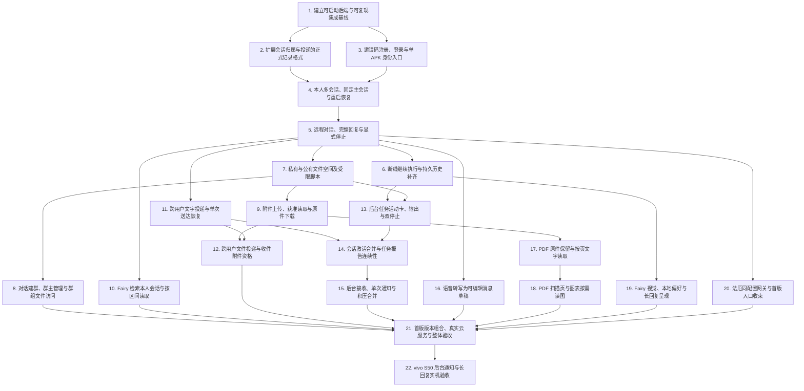

# 首版实施票与任务图

父规格：[OurFairy 首版总规格：受邀多用户后端与 Android 客户端](https://github.com/eafen405/OurFairy/issues/23)。

状态：用户已确认拆分，22 张实施票与 32 条原生依赖已发布并核验。列表序号是阅读顺序，实际身份见各票链接。

## 拆分原则

- 除可启动基线、原生格式前置和最终集成/设备验收外，每票形成可从产品接口或 UI 验证的完整行为。
- 原生格式票采用相容扩展并带必要消费者适配，独立保持构建/兼容检查通过；不将旧发布格式删除作为清理，不强拆必然留下损坏构建的迁移批次。
- 身份入口可与原生格式并行；普通远程对话形成共同接口后，恢复、文件执行、搜索、投递、ASR、网关配置均可独立推进。
- 通知真正等待任务、投递和活动归并；同文件修改只交给 worktree/合并处理，不制造产品依赖。
- 模型替身、真实云服务和目标真机证据分层；最后两票是实质验收门槛，不能为了让 implement-spec 全绿而省略或伪称通过。
- 父规格正文、状态及旧 wayfinder 决议保持不变；已创建原生子议题/依赖，全部标记 ready-for-agent。

## 已发布实施票

1. **建立可启动后端与可复现集成基线**
   - 阻塞于：无，可开始。
   - 交付：从可获取的固定来源启动最小 OurFairy 后端装配，形成 implement-spec 后续 worktree 共用的构建、版本组合和真实组合测试入口。此票是必要启动前置，不交付尚未适配的工具能力。
   - [GitHub 票面](https://github.com/eafen405/OurFairy/issues/24) · [本地副本](01-baseline.md)

2. **扩展会话归属与投递的正式记录格式**
   - 阻塞于：“建立可启动后端与可复现集成基线”。
   - 交付：让首版需要的永久归属和非模型投递记录能够通过正式会话接口保存、重启读取并被相关消费者识别，为后续用户会话和投递功能提供可编译的兼容基础。这是公共表示的前置改造，不建立第二套消息系统。
   - [GitHub 票面](https://github.com/eafen405/OurFairy/issues/25) · [本地副本](02-session-format.md)

3. **邀请码注册、登录与单 APK 身份入口**
   - 阻塞于：“建立可启动后端与可复现集成基线”。
   - 交付：法厄同能生成邀请，代理人在同一个 APK 注册并登录；客户端根据后端身份展示网关或对话入口，获得后续操作可用的可信身份。
   - [GitHub 票面](https://github.com/eafen405/OurFairy/issues/26) · [本地副本](03-identity.md)

4. **本人多会话、固定主会话与重启恢复**
   - 阻塞于：“扩展会话归属与投递的正式记录格式”、“邀请码注册、登录与单 APK 身份入口”。
   - 交付：已登录用户能在手机创建、列出、选择自己的会话并返回固定主会话；会话在后端重启后仍具有同一归属和访问范围。
   - [GitHub 票面](https://github.com/eafen405/OurFairy/issues/27) · [本地副本](04-owned-sessions.md)

5. **远程对话、完整回复与显式停止**
   - 阻塞于：“本人多会话、固定主会话与重启恢复”。
   - 交付：用户在手机发送文字，由后端 Fairy 运行并流式回复，完成后保存完整正文；用户能停止本轮回复。建立后续功能共同使用的远程会话投影。
   - [GitHub 票面](https://github.com/eafen405/OurFairy/issues/28) · [本地副本](05-remote-chat.md)

6. **断线继续执行与持久历史补齐**
   - 阻塞于：“远程对话、完整回复与显式停止”。
   - 交付：手机断线或切后台后后端继续工作，恢复连接时补齐保存的历史与当前回复状态，既不漏掉内容，也不把重复事件再次插入。
   - [GitHub 票面](https://github.com/eafen405/OurFairy/issues/29) · [本地副本](06-reconnect.md)

7. **私有与公有文件空间及受限脚本**
   - 阻塞于：“远程对话、完整回复与显式停止”。
   - 交付：用户通过 Fairy 读取、写入自己的私有空间和公有空间，并运行允许联网的脚本；真实文件和子进程都遵守同一用户范围。
   - [GitHub 票面](https://github.com/eafen405/OurFairy/issues/30) · [本地副本](07-space-execution.md)

8. **对话建群、群主管理与群组文件访问**
   - 阻塞于：“私有与公有文件空间及受限脚本”。
   - 交付：法厄同通过对话创建群组并指定群主，群主通过对话管理成员，Fairy 据当前成员资格读写群组文件。
   - [GitHub 票面](https://github.com/eafen405/OurFairy/issues/31) · [本地副本](08-group-spaces.md)

9. **附件上传、获准读取与原件下载**
   - 阻塞于：“私有与公有文件空间及受限脚本”。
   - 交付：用户在手机选择文件或图片，上传并发送给 Fairy；Fairy 通过获准文件/图片通路消费内容，用户能下载有资格的原件。
   - [GitHub 票面](https://github.com/eafen405/OurFairy/issues/32) · [本地副本](09-attachments.md)

10. **Fairy 检索本人会话与按区间读取**
   - 阻塞于：“远程对话、完整回复与显式停止”。
   - 交付：用户可在对话中让 Fairy 搜索本人其他会话，查看命中片段，再按原事件位置读取相关区间。
   - [GitHub 票面](https://github.com/eafen405/OurFairy/issues/33) · [本地副本](10-conversation-search.md)

11. **跨用户文字投递与单次送达恢复**
   - 阻塞于：“远程对话、完整回复与显式停止”。
   - 交付：Fairy 向指定用户编号投递文字，在收件主会话中显示普通 Fairy 消息；重试和故障恢复保持同一次送达，接收方无需启动推理。
   - [GitHub 票面](https://github.com/eafen405/OurFairy/issues/34) · [本地副本](11-text-delivery.md)

12. **跨用户文件投递与收件附件资格**
   - 阻塞于：“附件上传、获准读取与原件下载”、“跨用户文字投递与单次送达恢复”。
   - 交付：Fairy 在已确定的文字投递中附带获准文件，收件人可阅读引用并下载原件；部分失败不能被报告为完整送达。
   - [GitHub 票面](https://github.com/eafen405/OurFairy/issues/35) · [本地副本](12-file-delivery.md)

13. **后台任务活动卡、输出与双停止**
   - 阻塞于：“断线继续执行与持久历史补齐”、“私有与公有文件空间及受限脚本”。
   - 交付：Fairy 启动长脚本后继续对话，用户通过活动卡/详情查看输出或停止任务；手机断线后继续执行，任务结果回原会话。
   - [GitHub 票面](https://github.com/eafen405/OurFairy/issues/36) · [本地副本](13-jobs.md)

14. **会话激活合并与任务报告连续性**
   - 阻塞于：“跨用户文字投递与单次送达恢复”、“后台任务活动卡、输出与双停止”。
   - 交付：同一会话的 Fairy 执行、未结束任务、实际结果报告与投递输出形成统一激活状态，客户端观察到连续且按会话独立的活动。
   - [GitHub 票面](https://github.com/eafen405/OurFairy/issues/37) · [本地副本](14-activity.md)

15. **后台接收、单次通知与积压合并**
   - 阻塞于：“会话激活合并与任务报告连续性”。
   - 交付：自用 APK 在后台接收会话状态和内容，并按统一活动规则提醒；重连积压按会话合并，通知能定位正确会话。
   - [GitHub 票面](https://github.com/eafen405/OurFairy/issues/38) · [本地副本](15-notifications.md)

16. **语音转写为可编辑消息草稿**
   - 阻塞于：“远程对话、完整回复与显式停止”。
   - 交付：用户录音后通过后端硅基流动 ASR 得到可编辑文字，核对后自行发送；取消和失败不会把迟到文本写入错误草稿。
   - [GitHub 票面](https://github.com/eafen405/OurFairy/issues/39) · [本地副本](16-asr.md)

17. **PDF 原件保留与按页文字读取**
   - 阻塞于：“附件上传、获准读取与原件下载”。
   - 交付：用户上传 PDF 后，Fairy 可取得页数/目录或样本、选择页码读取文字并定位来源；原件仍可下载和继续追问。
   - [GitHub 票面](https://github.com/eafen405/OurFairy/issues/40) · [本地副本](17-pdf-text.md)

18. **PDF 扫描页与图表按需读图**
   - 阻塞于：“PDF 原件保留与按页文字读取”。
   - 交付：对于 PDF 扫描页、图表或复杂排版，Fairy 按需将指定页渲染为图片，使用已选官方视觉通路理解并保留页码。
   - [GitHub 票面](https://github.com/eafen405/OurFairy/issues/41) · [本地副本](18-pdf-vision.md)

19. **Fairy 视觉、本地偏好与长回复呈现**
   - 阻塞于：“断线继续执行与持久历史补齐”。
   - 交付：客户端保留 Fairy 视觉与本地显示偏好，长回复及时可读、流式时可滚动，结束/停止/错误后完整呈现格式并保持阅读位置。
   - [GitHub 票面](https://github.com/eafen405/OurFairy/issues/42) · [本地副本](19-presentation.md)

20. **法厄同配置网关与首版入口收束**
   - 阻塞于：“远程对话、完整回复与显式停止”。
   - 交付：法厄同能在网关查看/调整首版共用后端配置，代理人保持对话入口；APK 中未纳入首版的旧功能不可绕过产品职责被调用。
   - [GitHub 票面](https://github.com/eafen405/OurFairy/issues/43) · [本地副本](20-gateway.md)

21. **首版版本组合、真实云服务与整体验收**
   - 阻塞于：“对话建群、群主管理与群组文件访问”、“Fairy 检索本人会话与按区间读取”、“跨用户文件投递与收件附件资格”、“后台接收、单次通知与积压合并”、“语音转写为可编辑消息草稿”、“PDF 扫描页与图表按需读图”、“Fairy 视觉、本地偏好与长回复呈现”、“法厄同配置网关与首版入口收束”。
   - 交付：把所有已完成行为纳入一个可复现的首版版本组合，完成跨模块、双用户和真实官方服务验收，形成可交给 vivo 真机票的 release 构建。
   - [GitHub 票面](https://github.com/eafen405/OurFairy/issues/44) · [本地副本](21-integration.md)

22. **vivo S50 后台通知与长回复实机验收**
   - 阻塞于：“首版版本组合、真实云服务与整体验收”。
   - 交付：在目标 vivo S50 的首版 release 构建上验证后台接收、统一通知和长回复体验，并修复实际不符合规格的行为。
   - [GitHub 票面](https://github.com/eafen405/OurFairy/issues/45) · [本地副本](22-device.md)

## 依赖图

## 用户故事覆盖

- 1：邀请码注册、登录与单 APK 身份入口
- 2：邀请码注册、登录与单 APK 身份入口
- 3：邀请码注册、登录与单 APK 身份入口
- 4：邀请码注册、登录与单 APK 身份入口；远程对话、完整回复与显式停止
- 5：邀请码注册、登录与单 APK 身份入口；法厄同配置网关与首版入口收束
- 6：法厄同配置网关与首版入口收束
- 7：邀请码注册、登录与单 APK 身份入口；法厄同配置网关与首版入口收束
- 8：本人多会话、固定主会话与重启恢复
- 9：本人多会话、固定主会话与重启恢复
- 10：邀请码注册、登录与单 APK 身份入口；断线继续执行与持久历史补齐
- 11：本人多会话、固定主会话与重启恢复
- 12：本人多会话、固定主会话与重启恢复
- 13：本人多会话、固定主会话与重启恢复
- 14：本人多会话、固定主会话与重启恢复
- 15：远程对话、完整回复与显式停止
- 16：断线继续执行与持久历史补齐；后台任务活动卡、输出与双停止
- 17：远程对话、完整回复与显式停止；后台任务活动卡、输出与双停止
- 18：断线继续执行与持久历史补齐
- 19：Fairy 检索本人会话与按区间读取
- 20：Fairy 检索本人会话与按区间读取
- 21：Fairy 检索本人会话与按区间读取
- 22：本人多会话、固定主会话与重启恢复；Fairy 检索本人会话与按区间读取
- 23：远程对话、完整回复与显式停止
- 24：私有与公有文件空间及受限脚本；对话建群、群主管理与群组文件访问
- 25：私有与公有文件空间及受限脚本
- 26：私有与公有文件空间及受限脚本
- 27：对话建群、群主管理与群组文件访问
- 28：对话建群、群主管理与群组文件访问
- 29：对话建群、群主管理与群组文件访问
- 30：私有与公有文件空间及受限脚本；对话建群、群主管理与群组文件访问
- 31：私有与公有文件空间及受限脚本
- 32：私有与公有文件空间及受限脚本
- 33：跨用户文字投递与单次送达恢复；跨用户文件投递与收件附件资格
- 34：跨用户文字投递与单次送达恢复；跨用户文件投递与收件附件资格
- 35：跨用户文字投递与单次送达恢复；跨用户文件投递与收件附件资格
- 36：跨用户文字投递与单次送达恢复
- 37：跨用户文字投递与单次送达恢复
- 38：跨用户文字投递与单次送达恢复
- 39：跨用户文字投递与单次送达恢复
- 40：跨用户文件投递与收件附件资格
- 41：跨用户文字投递与单次送达恢复
- 42：附件上传、获准读取与原件下载
- 43：附件上传、获准读取与原件下载；跨用户文件投递与收件附件资格
- 44：附件上传、获准读取与原件下载；跨用户文件投递与收件附件资格
- 45：后台任务活动卡、输出与双停止
- 46：后台任务活动卡、输出与双停止
- 47：后台任务活动卡、输出与双停止
- 48：后台任务活动卡、输出与双停止
- 49：会话激活合并与任务报告连续性
- 50：会话激活合并与任务报告连续性
- 51：会话激活合并与任务报告连续性；vivo S50 后台通知与长回复实机验收
- 52：后台任务活动卡、输出与双停止；vivo S50 后台通知与长回复实机验收
- 53：后台接收、单次通知与积压合并；vivo S50 后台通知与长回复实机验收
- 54：后台接收、单次通知与积压合并；vivo S50 后台通知与长回复实机验收
- 55：后台接收、单次通知与积压合并；vivo S50 后台通知与长回复实机验收
- 56：后台接收、单次通知与积压合并；vivo S50 后台通知与长回复实机验收
- 57：后台接收、单次通知与积压合并；vivo S50 后台通知与长回复实机验收
- 58：后台接收、单次通知与积压合并；vivo S50 后台通知与长回复实机验收
- 59：后台接收、单次通知与积压合并；vivo S50 后台通知与长回复实机验收
- 60：后台接收、单次通知与积压合并；vivo S50 后台通知与长回复实机验收
- 61：后台接收、单次通知与积压合并；vivo S50 后台通知与长回复实机验收
- 62：断线继续执行与持久历史补齐；后台接收、单次通知与积压合并；vivo S50 后台通知与长回复实机验收
- 63：语音转写为可编辑消息草稿
- 64：语音转写为可编辑消息草稿
- 65：语音转写为可编辑消息草稿
- 66：PDF 原件保留与按页文字读取
- 67：PDF 扫描页与图表按需读图；vivo S50 后台通知与长回复实机验收
- 68：PDF 原件保留与按页文字读取；PDF 扫描页与图表按需读图
- 69：PDF 原件保留与按页文字读取；PDF 扫描页与图表按需读图
- 70：Fairy 视觉、本地偏好与长回复呈现
- 71：Fairy 视觉、本地偏好与长回复呈现
- 72：Fairy 视觉、本地偏好与长回复呈现；vivo S50 后台通知与长回复实机验收
- 73：Fairy 视觉、本地偏好与长回复呈现；vivo S50 后台通知与长回复实机验收
- 74：Fairy 视觉、本地偏好与长回复呈现；vivo S50 后台通知与长回复实机验收
- 75：Fairy 视觉、本地偏好与长回复呈现；vivo S50 后台通知与长回复实机验收

